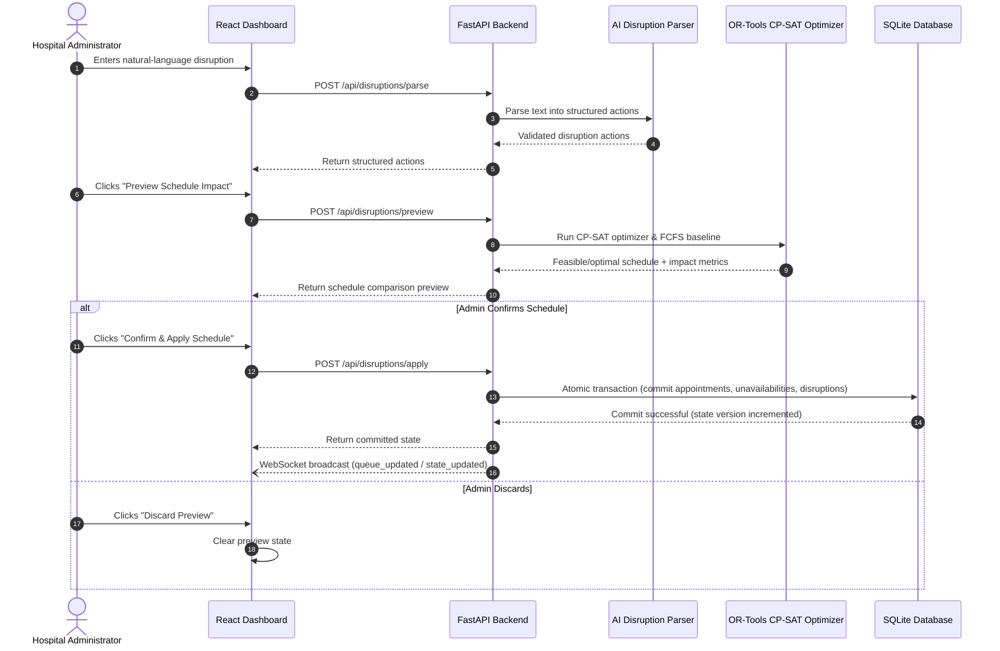
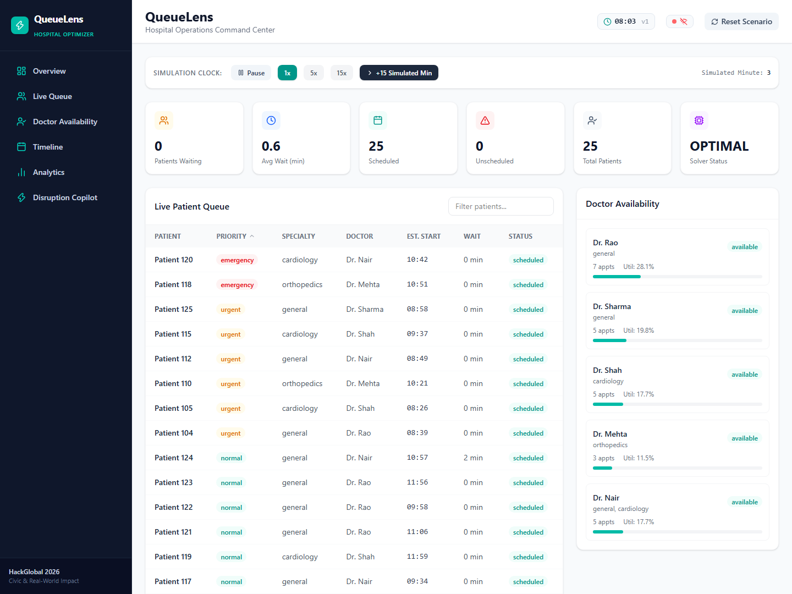
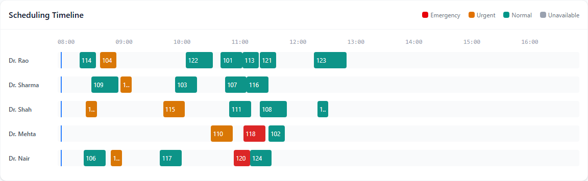
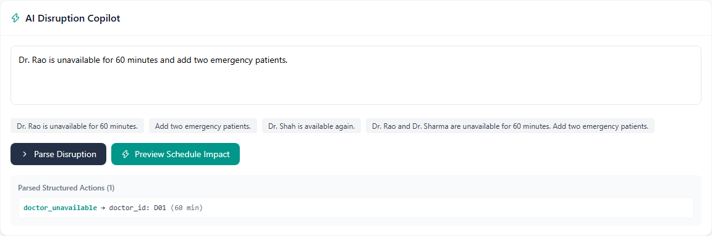
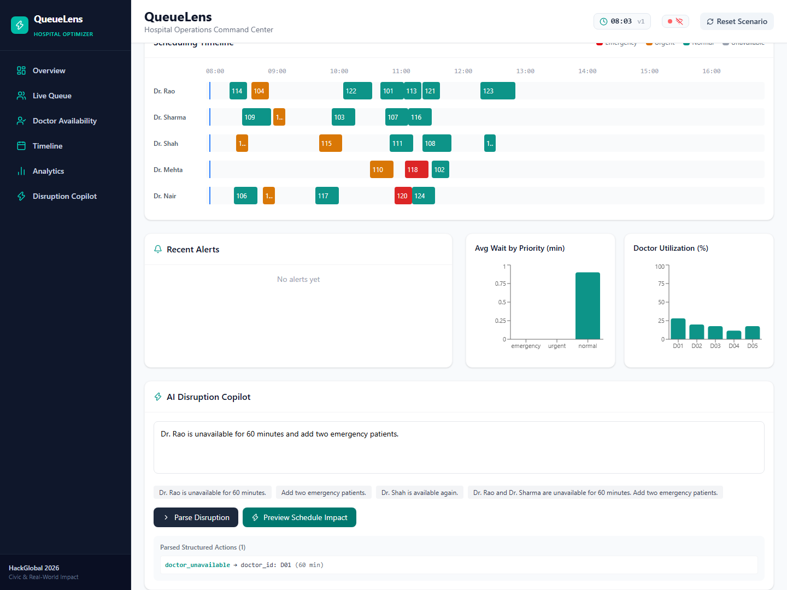

# QueueLens — Intelligent Queue Optimization & Adaptive Scheduling System

[](https://github.com/26rao/QueueLens)
[](LICENSE)
[](backend/tests/)

> **Track:** Civic and Real-World Impact  
> **Repository:** [https://github.com/26rao/QueueLens](https://github.com/26rao/QueueLens)  
> **Core Workflow:** Observe → Disrupt → Interpret → Optimize → Preview → Confirm → Update

---

## 1. Problem Statement

Hospitals and outpatient clinics operate under constrained clinical capacity, fluctuating patient demand, and unpredictable operational emergencies:
- Doctors abruptly become unavailable due to illness or urgent surgery.
- High-acuity emergency arrivals disrupt predefined schedules.
- Service durations exceed estimates, causing compounding delays across the queue.

Traditional scheduling relies on static appointments. When disruptions occur, hospital administrators are forced into manual triage shuffling on whiteboards or spreadsheets—delaying critical emergencies, multiplying patient wait times, and straining medical staff.

---

## 2. Proposed Solution

**QueueLens** is an AI-assisted hospital scheduling and queue optimization platform:
1. **Real-Time Operational Monitoring:** Live patient queues, doctor status, and multi-specialty Gantt scheduling timeline.
2. **AI Disruption Copilot:** Administrators describe operational changes in ordinary language (e.g. *"Dr. Rao is unavailable for 60 minutes and add two emergency patients"*).
3. **Dual-Mode Disruption Parser:** Offline deterministic regex parsing (zero external API keys required) plus optional LLM-assisted adapter.
4. **Google OR-Tools CP-SAT Constraint Optimization:** Enforces strict clinical eligibility, non-overlapping appointments, shift limits, and locked active treatments while minimizing weighted patient wait times.
5. **Explainable Impact Comparison:** Transparently shows pre-disruption metrics vs. a naive First-Come-First-Served (FCFS) baseline under disruption vs. the QueueLens optimized schedule.
6. **Live Concurrency & WebSocket Updates:** Atomic single-transaction database commits with state version conflict detection (HTTP 409) and real-time dashboard updates via WebSockets.

---

## 3. Architecture

### 3.1 Interaction Sequence



### 3.2 System Architecture

```text
User / Administrator Browser
             │
             ▼
┌──────────────────────────────────────────────────────────────┐
│                    Nginx Reverse Proxy                       │
│  - Serves React 18 / Vite Static SPA on /                    │
│  - Routes REST API on /api/*                                 │
│  - Upgrades WebSockets on /ws                                │
└──────────────────────────────────────────────────────────────┘
             │                                   │
             ▼                                   ▼
┌────────────────────────┐           ┌─────────────────────────┐
│     React Frontend     │           │     FastAPI Backend     │
│  - Tailwind CSS v4     │           │  - REST Endpoints       │
│  - Lucide React Icons  │           │  - WebSocket Manager    │
│  - Recharts Analytics  │           │  - Simulation Clock     │
└────────────────────────┘           └─────────────────────────┘
                                                  │
                 ┌────────────────────────────────┼────────────────────────────────┐
                 ▼                                ▼                                ▼
    ┌────────────────────────┐       ┌────────────────────────┐       ┌────────────────────────┐
    │   OR-Tools CP-SAT      │       │   AI Disruption Parser │       │   SQLite Database      │
    │   Constraint Solver    │       │   - Deterministic      │       │   - Doctors & Shifts   │
    │   - Hard Constraints   │       │   - Optional LLM       │       │   - Patients & Queues  │
    │   - Multi-Objective    │       │   - Preview Cache      │       │   - Appointments       │
    │   - Fallback FCFS      │       │   - Conflict Detection │       │   - Disruptions Log    │
    └────────────────────────┘       └────────────────────────┘       └────────────────────────┘
```

*Detailed architectural breakdown and KaTeX mathematical formulations available in [docs/architecture.md](docs/architecture.md).*

---

## 4. Screenshots

Captured directly from the running QueueLens application:

### Operations Command Center Dashboard


### Scheduling Timeline (Gantt View)


### AI Disruption Copilot


### Optimization Impact Comparison


---

## 5. Demonstration Recording

- **Demo Video Walkthrough:** [QueueLens Demo Walkthrough](docs/demo-script.md)
- **Judging Demo Script:** Follows the 90-second structured script in [docs/demo-script.md](docs/demo-script.md).

---

## 6. Verified Benchmark Results

All benchmarks are reproducible and measured directly from the seeded scenario (5 doctors, 25 patients) comparing the QueueLens CP-SAT solver against a standard FCFS baseline under identical constraints:

| Scenario | Baseline Wait | QueueLens Wait | Wait Time Reduction | Solver Status | Execution Time |
|---|---|---|---|---|---|
| **1. Normal Operations** | 8.5 min | 0.6 min | **+92.9%** | OPTIMAL | 184 ms |
| **2. Single Doctor Outage** (60 min) | 11.0 min | 0.6 min | **+94.5%** | OPTIMAL | 250 ms |
| **3. Emergency Surge** (+2 Emergency) | 7.5 min | 1.3 min | **+82.7%** | OPTIMAL | 311 ms |
| **4. Compound Disruption** (2 Doctors Out + Emergencies) | 44.7 min | 8.3 min | **+81.4%** | FEASIBLE | 2,166 ms |

*See [docs/benchmark-results.md](docs/benchmark-results.md) for full scenario specifications.*

---

## 7. Technology Stack

| Layer | Technology | Purpose |
|---|---|---|
| **Frontend** | React 18, Vite, TypeScript | Interactive responsive dashboard |
| **Styling** | Tailwind CSS v4, Lucide React | High-density operational interface |
| **Charts** | Recharts | Waiting time distribution and doctor utilization |
| **Backend** | Python 3.11+, FastAPI, Uvicorn | REST APIs, WebSockets, background simulation |
| **Constraint Solver** | Google OR-Tools CP-SAT | Mathematical constraint satisfaction optimization |
| **Database** | SQLite + SQLAlchemy 2.0 | Persistent relational storage with foreign keys |
| **AI Parsing** | Deterministic Regex + Optional OpenAI API | 100% offline functionality with optional LLM |
| **Reverse Proxy** | Nginx | Static asset delivery, API routing, WebSocket upgrade |
| **Deployment** | Docker Compose | Single-server container orchestration on Vultr |

---

## 8. Local Setup & Verification

### Prerequisites
- Node.js 18+ and npm
- Python 3.11+ (Python 3.13 supported)

### Step 1: Clone Repository
```powershell
git clone https://github.com/26rao/QueueLens.git
cd QueueLens
```

### Step 2: Backend Setup
```powershell
cd backend
python -m venv .venv
.\.venv\Scripts\Activate.ps1
pip install -r requirements.txt
uvicorn app.main:app --port 8000
```
- Health Check: `Invoke-RestMethod http://localhost:8000/api/health`
- Swagger UI Docs: `http://localhost:8000/docs`

### Step 3: Frontend Setup
In a second PowerShell window:
```powershell
cd frontend
npm install
npm run dev
```
Open `http://localhost:5173/` in your browser.

---

## 9. Automated Tests

Run backend tests using pytest:
```powershell
cd backend
.\.venv\Scripts\pytest -v
```
**Results:** `19 passed in 1.66s` (covers scheduler constraints, FCFS fallback, schedule validator, disruption parser, metric calculations, and API endpoints).

Build the frontend:
```powershell
cd frontend
npm run build
```
**Results:** Production build completed with `0` TypeScript errors.

---

## 10. Docker & Vultr Cloud Deployment

QueueLens is configured for single-command deployment on **Vultr Cloud Compute** (Ubuntu 22.04 / 24.04 LTS).

### Environment Setup (`.env`)
Create `.env` in the repository root:
```dotenv
APP_ENV=production
DATABASE_URL=sqlite:////app/data/queuelens.db
PLANNING_HORIZON=480
CORS_ORIGINS=*
LLM_ENABLED=false
LLM_API_KEY=
LLM_BASE_URL=
LLM_MODEL=
```

### Launch Container Services
```bash
docker compose up -d --build
docker compose ps
curl http://localhost/api/health
```

The application is served on port 80 via Nginx.

---

## 11. HackGlobal 2026 Submission Information

- **Project:** QueueLens — Intelligent Queue Optimization & Adaptive Scheduling System
- **Track:** Civic and Real-World Impact
- **Event:** HackGlobal 2026
- **Repository:** [https://github.com/26rao/QueueLens](https://github.com/26rao/QueueLens)

---

## 12. Scope & Disclaimer

> [!IMPORTANT]
> QueueLens is a hackathon prototype developed for **HackGlobal 2026** using synthetic hospital operational data. It is **not** a validated medical triage device or clinical decision-support system. Medical urgency and clinical triage categories are provided as external inputs. Production hospital deployment requires formal clinical validation, patient privacy compliance, and hospital EHR integration (HL7/FHIR).
