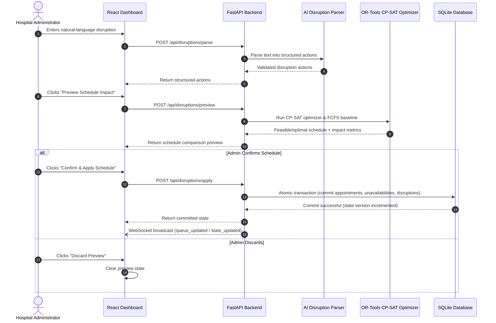

# QueueLens System Architecture

QueueLens is an intelligent queue optimization and adaptive scheduling system for hospital operations.

---

## Architecture Diagram



---

## Component Layout

```
Internet / User Browser
         │
         ▼
┌─────────────────────────────────────────────────────────────┐
│                    Reverse Proxy (Nginx)                    │
│  - Serves React 18 / Vite Static SPA on /                   │
│  - Routes REST API on /api/*                                │
│  - Proxies WebSockets on /ws                                │
└─────────────────────────────────────────────────────────────┘
         │                                 │
         │ (Static SPA Bundle)             │ (API & WebSocket traffic)
         ▼                                 ▼
┌──────────────────┐             ┌────────────────────────────┐
│  React Frontend  │             │      FastAPI Backend       │
│  - Tailwind CSS  │             │  - REST Endpoints          │
│  - Recharts      │             │  - Simulation Clock Task   │
│  - WebSocket Hook│             │  - Connection Manager (WS) │
└──────────────────┘             └────────────────────────────┘
                                               │
                     ┌─────────────────────────┼─────────────────────────┐
                     │                         │                         │
                     ▼                         ▼                         ▼
          ┌────────────────────┐    ┌────────────────────┐    ┌────────────────────┐
          │  OR-Tools CP-SAT   │    │    AI Disruption   │    │ SQLite Persistent  │
          │  Optimizer Engine  │    │    Copilot Engine  │    │ Storage Engine     │
          │  - Hard Constraints│    │  - Deterministic   │    │  - Patients & Docs │
          │  - Multi-Objective │    │    Regex Parser    │    │  - Appointments    │
          │  - FCFS Fallback   │    │  - Optional LLM    │    │  - Disruptions     │
          │  - Validations     │    │  - Preview Cache   │    │  - Simulation State│
          └────────────────────┘    └────────────────────┘    └────────────────────┘
```

---

## Core Operational Interaction Lifecycle

1. **Observe:** The dashboard initializes by loading authoritative hospital state (5 doctors, 25 patients, initial schedule) via `GET /api/state`.
2. **Disrupt:** The administrator describes an operational disruption in natural language (e.g., *"Dr. Rao and Dr. Sharma are unavailable for 60 minutes. Add two emergency patients."*).
3. **Interpret:** The AI Disruption Parser converts plain text into validated structured disruption actions (`doctor_unavailable`, `add_emergency`, `cancel_appointment`).
4. **Optimize & Preview:** `POST /api/disruptions/preview` runs Google OR-Tools CP-SAT and the baseline scheduler against an in-memory candidate state, evaluates metrics, and caches the preview tied to the current `state_version`.
5. **Review & Compare:** The administrator reviews the explainable Impact Comparison comparing baseline disruption metrics against QueueLens optimization.
6. **Commit & Propagate:** `POST /api/disruptions/apply` verifies the state version (rejecting conflicts with HTTP 409), commits all changes in a single SQLite transaction, increments state version, and broadcasts real-time events over WebSockets.

---

## Mathematical Optimization Model (Google OR-Tools CP-SAT)

The scheduler minimizes:

$$\min \sum_{i} w_i W_i + \lambda \sum_{i} D_i + \mu \sum_{i} L_i + \rho \sum_{i} U_i$$

Where:
- $W_i$: Patient waiting time from arrival: $\max(0, \text{start}_i - \text{arrival}_i)$
- $w_i$: Priority weight (Emergency = 100, Urgent = 10, Normal = 1) + aging bonus
- $D_i$: Schedule disturbance penalty: $|\text{start}_i - \text{previous\_start}_i|$
- $L_i$: Appointment lateness delay
- $U_i$: Binary unscheduled indicator with heavy penalty ($\rho = 10,000$)

### Hard Constraints
1. **Unique Assignment:** Schedulable patients assigned to at most 1 doctor.
2. **Specialty Eligibility:** Doctors only treat patients requiring supported specialties.
3. **No-Overlap:** Optional interval variables with `AddNoOverlap` per doctor.
4. **Shift Boundaries:** Appointments must finish within doctor shift minutes (0–480).
5. **Arrival Time:** Start time $\ge$ patient arrival time.
6. **Simulation Horizon:** Start time $\ge$ current simulation minute.
7. **Unavailability Intervals:** Non-overlap with doctor outage windows.
8. **Locked Ongoing Treatments:** In-progress appointments are preserved without disruption.
